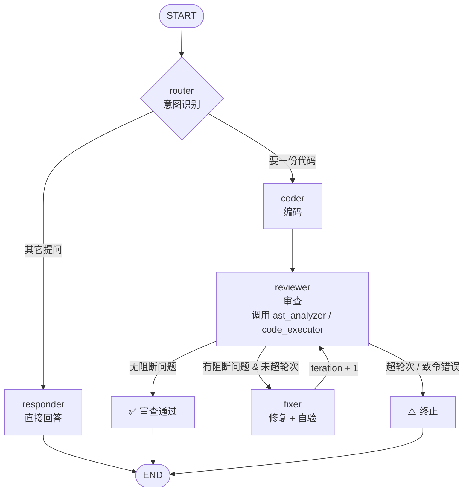

# 多 Agent 协作 Workflow（编码 → 审查 → 修复）

> 课程作业 · 基于 LangGraph 的多 Agent 代码协作流水线

三类模型配置驱动六个协作角色，覆盖从需求澄清到代码生成、审查与修复的完整流程：

```
你随便说一句话
  → router    先判断：这是要代码，还是在问问题？

  要代码（写一个函数…）
    → coder     生成首版代码
    → reviewer  静态分析 + 运行验证 + 产出结构化 findings
    → fixer     逐条修复 + 自验（不通过就带错误再修一次）
    → reviewer  复审 → 还有阻断问题就继续修 → 直到通过或达上限

  其它提问（你能做什么）
    → responder 直接给一段回答，不会被塞进代码流水线
```

**流水线内的多个 Agent 既共享状态（数据黑板），也显式互发消息（消息总线）**，
每一步都写进运行记录 JSON，可追踪、可复现、可中断续跑。

---

## 30 秒跑通（该部分为离线部分，不需要 API Key）

```bash
python examples/offline_demo.py
```

用脚本化假模型演两条分支（同样的图、节点、条件边、自验、运行记录）：

1. 代码任务：编码 → 审查 → 修复 → 复审 → 通过
2. 自由提问：“你能做什么” → 直接得到回答

输出带消息时间线的完整日志。想接真实模型见下面的「快速开始」。

---

## 模型分工

| Agent | 角色 | 职责 | 为什么这样分 |
|---|---|---|---|
| **chat** | 对话（工作模式前台） | 陪聊、答疑、读文件、跑验证、写文件；需求清楚时提任务提案 | 用 mimo-v2.6-pro（支持工具调用）；唯一直接面对用户的角色 |
| **router** | 意图识别 | 流水线图内部分流（程序化调用 / 离线演示用） | 规则优先（零延迟），拿不准才叫一次快模型 |
| **responder** | 问答 | 流水线图内部的轻量问答分支 | 复用 coder 的模型配置 |
| **coder** | 编码 | 根据需求生成完整可运行代码 | 代码生成模型，先出初稿 |
| **reviewer** | 审查 | 静态分析 + 运行验证 + 结构化 findings | 中文表达稳定的模型，适合输出结构化报告；且被循环反复调用 |
| **fixer** | 修复 | 精准修复 + 自验 | 推理深度最高的一档，修复要"读问题→定位→改" |

模型名、base_url、API Key 全部走 `.env`，角色与模型解耦：换模型不用改代码。

---

## 图结构

工作模式其实是**两层**：前台是带记忆、带工具的对话 Agent，后台才是代码流水线。

```text
你 ──→ chat（mimo-v2.6-pro，多轮记忆）
          │  随时可调：file_reader / code_executor / ast_analyzer / write_file（写前确认）
          │
          └─ 需求聊清楚了 → 提任务提案 → 你确认 → 触发下面的流水线
                                    ↓
                        coder → reviewer ⇄ fixer ──→ 结果回灌到对话上下文
```

流水线自身的图结构：



对应的 Mermaid 文件由代码自动导出，不会和实现脱节：

```bash
python cli_multi.py --graph workflow_graph.mmd
```

---

## 快速开始

### 1. 安装依赖

```bash
pip install -r requirements.txt
```

### 2. 配置密钥

```bash
copy .env.example .env        # Windows
cp .env.example .env          # macOS / Linux
```

编辑 `.env`，填入三组模型配置（环境变量前缀固定为 `CODER_*` / `REVIEWER_*` / `FIXER_*`）。

> 安全提示：`.env` 只用于本地运行，已被 `.gitignore` 排除。仓库只保留不含真实密钥的 `.env.example`；运行记录和本地沙箱目录同样默认不入库。

开跑前建议先自检一次：

```bash
python examples/check_env.py     # 使用 .env 中的 Key 检查 DNS / 连通性 / 模型名
```

### 3. 进入工作模式

```bash
python cli_multi.py                     # 直接进工作模式
python cli_multi.py --root D:\code      # 追加可读写目录
python cli_multi.py --max-rounds 2      # 流水线最多修 2 轮
python cli_multi.py --run-dir my_runs   # 指定运行记录目录
python cli_multi.py --no-record         # 不写运行记录
```

进去就是一个多轮会话，想问什么问什么：

```text
你 › 这个项目怎么做代码审查的
你 › 用 file_reader 看看 workflow_graph.mmd 里有哪些节点
你 › 帮我写一个 median 函数，处理空列表和偶数长度
     ← 需求够清楚了，它会提一份任务提案，回车确认后才跑流水线
```

会话内指令：

| 指令 | 作用 |
|---|---|
| `/task <需求>` | 强制当代码任务执行（跳过模型判断） |
| `/resume <记录>` | 从 `runs/xxx.json` 继续跑流水线 |
| `/clear` | 清空对话记忆（进程内，关掉窗口也会丢） |
| `/help` | 查看指令 |
| `/exit` | 退出（`quit` / `q` 同效） |

对话 Agent 能调四个工具：`file_reader`（读文件）、`code_executor`（跑受限代码）、
`ast_analyzer`（静态分析）、`write_file`（写文件，**每次写入都会先弹确认**）。

### 4. 中断后续跑

```bash
dir runs                                            # 先看有哪些记录
```

然后在工作模式里输入 `/resume runs/16617fab.json`：会新起一份记录，
并标注 `resumed_from` 指向原文件。

### 5. 离线导出图结构（不需要 API Key）

```bash
python cli_multi.py --graph workflow_graph.mmd
```

---

## 目录结构

```
agent-homework2/
├── cli_multi.py            # 命令行入口：参数解析 / 事件渲染 / 结果汇总
├── config.py               # 集中配置（三组 LLM + 韧性参数 + 沙箱边界）
├── .env.example            # 环境变量模板
├── .gitignore              # 排除本地密钥、运行记录与缓存
│
├── multi_agent/            # 多 Agent 核心
│   ├── state.py            # 共享状态 WorkflowState + 消息/错误/快照结构
│   ├── messages.py         # 消息总线：AgentMessage 构造与渲染
│   ├── conversation.py     # 工作模式对话层：记忆 + 工具 + 任务提案
│   ├── intent.py           # 意图识别：规则 → 模型 → 兜底 code
│   ├── severity.py         # 严重级别与阻断阈值判定
│   ├── resilience.py       # 节点级重试、工具降级、错误标记
│   ├── text_utils.py       # 代码块剥离、模型输出取文本、JSON 提取
│   ├── llm_factory.py      # 三个流水线 LLM + 一个对话 LLM（工厂）
│   ├── edges.py            # 入口分支 + 审后分支 + 续跑推算
│   ├── graph.py            # 图组装（可注入模型 + 可指定入口节点）
│   ├── runner.py           # 执行器：驱动图、采集事件、写运行记录
│   ├── recorder.py         # 运行记录 JSON：时间线 + 状态快照 + 原子写
│   ├── prompts/            # 五个角色的系统提示词（含 router / responder）
│   └── nodes/              # 五个节点（工厂 + 纯函数）
│
├── tools/                  # 复用的工具集
│   ├── ast_analyzer.py     # AST 静态分析（analyze_code + LangChain 工具）
│   ├── code_executor.py    # 受限执行（execute_code 结构化 + 工具封装）
│   ├── file_reader.py      # 读文件（白名单 + 敏感拦截）
│   ├── file_writer.py      # 写文件（白名单 + 敏感拦截 + 每次确认）
│   └── sandbox_policy.py   # 执行前 AST 策略校验
│
├── examples/
│   ├── offline_demo.py     # 不需要 Key 的双幕演示（代码任务 + 自由提问）
│   └── check_env.py        # 开跑前自检：DNS / 连通性 / 模型名
│
├── tests/                  # 181 个用例，全部离线可跑
└── runs/                   # 运行记录（自动生成，默认不入库）
```

---

## 三种协作机制

### 1. 共享状态（数据黑板）

| 字段 | 写入者 | 读取者 | 说明 |
|---|---|---|---|
| `requirement` | 用户输入 | router、coder、responder | 原始输入（需求或提问） |
| `mode` | router | 入口条件边 | `code` / `chat`，决定走哪条分支 |
| `answer` | responder | CLI、运行记录 | 问答分支的自然语言回答 |
| `current_code` | coder、fixer | reviewer、fixer | 当前最新代码 |
| `code_history` | coder、fixer | 运行记录、CLI | 每一版代码快照（累加） |
| `findings` | reviewer | fixer、条件边 | 结构化问题清单 |
| `review_history` | reviewer | 运行记录 | 每轮 severity 分布（累加） |
| `self_check` | fixer | reviewer | 修复后自验结果 |
| `iteration` / `max_iterations` | fixer / 初始注入 | 条件边 | 循环控制 |
| `messages` | 各节点 | CLI、运行记录 | 消息时间线（累加） |
| `errors` | 各节点 | 条件边、CLI | 降级/致命错误（累加） |
| `status` / `log` | 各节点 | CLI | 当前阶段 / 执行日志 |

### 2. 消息总线（谁对谁说了什么）

状态负责「数据在哪」，消息负责「过程发生了什么」。每条消息是结构化的
`AgentMessage{id, sender, recipient, kind, summary, iteration, payload}`：

| 发送方 → 接收方 | kind | 含义 |
|---|---|---|
| router → coder / responder | `handoff` | 识别为代码任务 / 自由问答 |
| coder → reviewer | `handoff` | 首版代码就绪 |
| reviewer → tools | `report` | 工具执行结果（AST / 运行验证是否降级） |
| reviewer → fixer | `request_fix` | 请求修复，payload 带 severity 分布 |
| reviewer → workflow | `verdict` | 审查结论（无阻断问题通过，可带非阻断建议数） |
| responder → workflow | `verdict` | 已给出回答 |
| fixer → reviewer | `handoff` | 第 N 轮修复完成 + 自验结果 |
| 任意 → workflow | `error` | 致命错误通知 |

### 3. 条件边路由

入口分支（只看 mode，不做业务判断）：

```python
def route_after_router(state):
    return "chat" if state.get("mode") == "chat" else "code"
```

审后分支（注意：只有**阻断级别**的问题才算问题）：

```python
def route_after_review(state):
    if has_fatal_error(state["errors"]) or state["status"] == "failed":
        return "give_up"                 # 有致命错误：绝不误判为"审查通过"
    if not blocking_findings(state["findings"]):
        return "passed"                  # 只剩 info 级建议 → 算通过
    if state["iteration"] >= state["max_iterations"]:
        return "give_up"                 # 修太多轮还没好 → END（带剩余阻断问题）
    return "fix"                         # 继续修
```

阻断阈值由 `WORKFLOW_BLOCKING_SEVERITIES` 控制（默认 `critical,warning`）。
**通过 = 无阻断问题，不等于零建议**：info 级建议照旧完整记在 `findings` 与运行记录里。

---

## 韧性设计（错误处理与恢复）

| 层 | 失败场景 | 处理方式 |
|---|---|---|
| 模型调用 | 5xx / 网络抖动 / 连接断开 | 节点级指数退避重试（默认 3 次），记录尝试次数 |
| 模型调用 | 请求超时 | **不重试**，直接失败并给出明确原因（推理模型慢 ≠ 瞬时抖动） |
| 模型调用 | 重试后仍失败 | 记 `fatal=True` 错误 → 条件边终止，**不会**被当成通过 |
| 工具 | AST 分析抛异常 | 降级为一条可恢复错误，审查继续（结论里标注"工具降级"） |
| 工具 | 执行环境不可用（临时目录不可写等） | 返回结构化错误，不抛异常；fixer 不会无意义地重试 |
| 工具 | 代码触发安全策略 | 返回"已拒绝执行"，交给模型判断 |
| fixer | 自验未通过 | 带错误反馈自动再修一次（可配置次数），减少外层轮次 |
| 模型输出 | 带 Markdown 代码块 | 自动剥离 |
| 模型输出 | JSON 前后有解释文字 / 包在对象里 | 多级兜底解析，仍失败则包成一条 warning finding |
| 图 | 死循环 | `AGENT_RECURSION_LIMIT` 兜底 |
| 循环 | 修复轮次超限 | `WORKFLOW_MAX_FIX_ROUNDS` 兜底，输出剩余问题 |
| 终端 | Windows GBK 控制台打印 emoji | stdout 切 UTF-8，失败时 replace 而不是崩 |
| 终端 | 管道输入编码不匹配（产生孤立代理字符） | 非交互时 stdin 切 UTF-8，并在入口清洗代理字符 |
| 对话 | 模型想写文件 | 每次弹确认（展示路径 + 理由 + diff / 内容预览），拒绝就不写 |
| 对话 | 工具想越界写（目录外 / .env / 目录） | 工具层直接拒绝，且不会弹确认浪费你时间 |
| 对话 | 单轮工具循环太久 | `AGENT_RECURSION_LIMIT` 兜底，只中止本轮、不退出会话 |
| 运行记录 | 目录不可写 | 自动降级为"不落盘"，不影响主流程 |

**重试策略只有两层保护，都是实测逼出来的**：

1. **SDK 层不重试**（`LLM_HTTP_MAX_RETRIES=0`）：重试统一由节点层负责。
   两层同时重试会相乘——3 次节点重试 × 3 次 SDK 重试 × 60s 超时 ≈ 9 分钟才报错，实测过一次。
2. **超时不重试**：推理模型的超时通常意味着“它本来就很慢”。实测 glm-5.3-flash
   对一段 1.5KB 的审查提示要跑 121 秒，这种超时重试三次只会把失败推迟到几分钟后。

于是最坏情况收敛到“一次请求超时”，而不是重试次数的乘积。

---

## 运行记录与中断续跑

每次运行写一份 `runs/<run_id>.json`（临时文件 + 原子替换，不会留半截文件）：

```jsonc
{
  "run_id": "16617fab",
  "entry": "router",
  "last_node": "reviewer",          // 续跑时据此推算下一步
  "timeline": [                     // 每个节点一行：日志 + 消息
    {"node": "router", "at": "...", "status": "routing", "log": [...], "messages": [...]},
    {"node": "coder", "at": "...", "status": "coding", "log": [...], "messages": [...]}
  ],
  "snapshot": { /* 最近一次完整状态，/resume 直接拿来当初始状态 */ },
  "result": {"terminal": "failed", "node_calls": {"coder": 1, "reviewer": 1},
             "elapsed_seconds": 553.6, "findings": 0, "errors": 1}
}
```

`/resume` 会读取 `last_node` 与状态快照，推算应该从哪个节点继续
（router 之后 → coder / responder；coder 之后 → reviewer；reviewer 之后 → fixer 或已结束），
再以该节点为入口重建图。

---

## 运行测试

```bash
# 不需要 API Key、不联网
python -m unittest discover -s tests -t . -v
```

| 测试文件 | 覆盖内容 |
|---|---|
| `test_edges.py` | 入口分支 + 审后全部分支（passed / fix / give_up / 致命错误 / info 不阻断）+ 续跑推算 |
| `test_graph.py` | 端到端：代码任务四种结局 + 自由问答分支 + 消息时间线 + 代码版本 + 多次 build 不串味 |
| `test_nodes.py` | router 意图识别（含显式 mode）、responder 回答、reviewer 降级、fixer 自验与自修复 |
| `test_resilience.py` | 重试与退避上限、超时不重试、工具异常吞掉、LLM 调用不抛异常 |
| `test_runner.py` | 事件采集、JSON 落盘、时间线、续跑场景、结论判定（含 answered / info 通过） |
| `test_severity.py` / `test_intent.py` | 阻断阈值、级别归一化、意图规则与模型兜底 |
| `test_conversation.py` | 对话层：记忆跨轮保持、线程隔离、历史裁剪、工具回路、任务提案解析、结果回灌 |
| `test_file_writer.py` | 写文件：目录外 /.env / 目录目标全部拒绝；确认后才写；允许覆盖 |
| `test_messages.py` / `test_text_utils.py` / `test_llm_factory.py` / `test_sandbox_policy.py` | 消息构造、文本/JSON 兜底解析、单层重试策略、策略白名单 |

---

## 评分维度对照

| 维度 | 权重 | 本方案落点 |
|---|---|---|
| **流程完整性** | 40% | 入口先路由（要代码 / 要回答）；代码任务走 编码→审查→（修复→复审）闭环，产出代码 + findings + 消息时间线 + 运行记录；`examples/offline_demo.py` 两条分支都能无 Key 复现 |
| **Agent 协作** | 30% | 五个流水线角色（router / coder / reviewer / fixer / responder）分工明确；三组独立模型配置，router / responder 默认复用 coder，chat 默认复用 fixer；共享状态黑板 + 结构化消息总线；两级条件边路由；循环计数 + 致命错误保护，绝不把失败误判成通过 |
| **可扩展性** | 20% | 加 Agent = 加 prompt + 加 node + 加一条边；节点走工厂注入、图可指定入口；换模型改 `.env`；工具层零改动复用；执行器与 CLI 解耦 |
| **文档** | 10% | README + Design.md + 自动导出的 Mermaid 图 + 状态/消息/错误三张表 + 韧性矩阵 |

---

## 与原单 Agent 项目的关系

| 对比项 | 原项目（agent-homework） | 本项目（agent-homework2） |
|---|---|---|
| Agent 数量 | 1 个（审查员） | 5 个（意图识别 / 编码 / 审查 / 修复 / 问答） |
| 模型 | 单模型 | 三个独立模型配置，按角色分配（router / responder 默认复用 coder） |
| 流程 | ReAct 工具循环 | 顺序 + 条件分支 + 循环 + 可续跑 |
| 状态 | MessagesState（纯消息） | WorkflowState（代码 / findings / 计数 / 消息 / 错误） |
| 通信 | 隐式（对话历史） | 共享状态 + 显式 AgentMessage |
| 工具 | 三件套 | 完全复用，另加结构化调用接口 |
| 输出 | 自然语言审查报告 | 代码任务产出代码 + findings；提问直接产出回答；两者都写运行记录 JSON |
| 韧性 | 无 | 节点级重试、工具降级、致命错误保护、自验闭环 |

---

## 常见问题

| 现象 | 原因 | 处理 |
|---|---|---|
| `Unsupported model xxx` | 模型名不在端点清单里 | 用 `GET {base_url}/models` 查可用清单再填（例如小米端点只有 `mimo-v2.5*` / `mimo-v2.6*`） |
| `OpenAITimeoutError: Request timed out` | 推理模型很慢，超时设太小 | 实测 glm-5.3-flash 审一段 1.5KB 代码要 121s，建议 `LLM_REQUEST_TIMEOUT=180` |
| `getaddrinfo failed` | base_url 域名写错 | 先 `ping` / `nslookup` 确认能解析；不通的域名会直接报错不会重试 |
| “运行验证=被策略拒绝” | 生成代码触发了执行策略 | 看运行记录里的 `exec_policy_reason` 字段，里面有具体原因 |
| 审查总在报问题、永远不“通过” | reviewer 把 info 级 nit 也算问题 | 调 `WORKFLOW_BLOCKING_SEVERITIES`（默认 `critical,warning`），只剩 info 时即算通过 |
| 模型不肯提交任务提案 | 需求还不够具体 | 把输入输出、边界说清楚；或直接 `/task <需求>` 强制执行 |
| 中文问题报 `UnicodeEncodeError ... surrogates` | 管道 / 重定向输入的编码与终端不一致 | 已在入口清洗代理字符 + 非交互时切 UTF-8；若仍出现，改用真实终端输入 |
| 关掉窗口后对话忘了 | 会话记忆是进程内的（按设计不落盘） | 需要长期保存的话，用 `/task` 让流水线把成果写进文件与 runs/ 记录 |
| 想确认到底跑在哪一步 | - | 看 `runs/<run_id>.json` 的 timeline 与 result |


## 已知限制

1. **reviewer 的结论依赖模型遵守 JSON 格式**：格式不符时会降级成一条 warning finding，不崩溃。
2. **fixer 的自验只覆盖"能跑通"**：执行成功不代表业务语义正确，仍需 reviewer 复审。
3. **单文件粒度**：不支持多文件 / 目录级协作。
4. **运行记录不含 token 用量**：模型侧未回传 usage 时无法统计成本。
5. **续跑以节点为粒度**：续跑会重跑该节点，不做节点内断点。
6. **任务提案由模型判断**：需求不够具体时它可能先追问而不提交；想强行开工就用 `/task <需求>`。
7. **对话记忆是进程内的**：`MemorySaver` 关掉进程即失效，按设计不做跨进程落盘。
8. **写文件是同步阻塞确认**：写入时整个会话会等你按 y/n；没有实现“后台并行写”。
